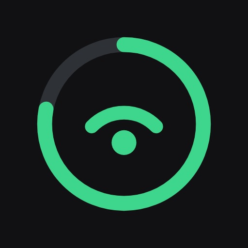
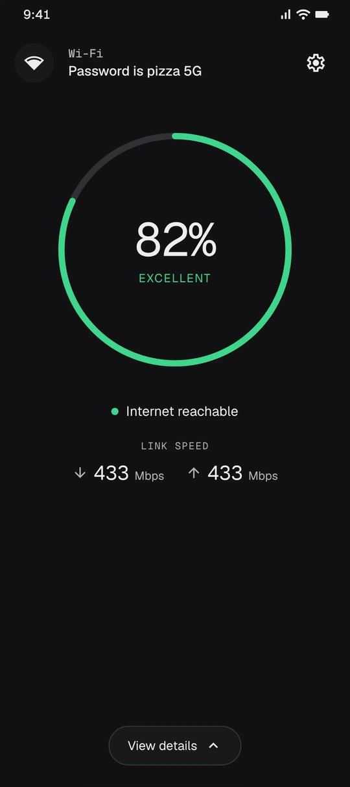

<div align="center">



# My Connection

Find your best Wi-Fi signal.

[Website](https://myconnection.zanin.dev) ·
[Google Play](https://play.google.com/store/apps/details?id=dev.zanin.myconnection) ·
[Changelog](https://myconnection.zanin.dev/changelog) ·
[Privacy](https://myconnection.zanin.dev/privacy-policy)

</div>



My Connection is an Android app that shows how good your connection is right now, in plain language. Walk around the house and watch the signal change to find the spot that works best.

- **Signal at a glance:** strength as a percentage and a label (Excellent, Good, Fair, Weak).
- **Live updates:** refreshes on its own, at an interval you choose.
- **Details when you want them:** link speed, SSID, BSSID, frequency and IP, ready to copy.
- **Any connection:** Wi-Fi, cellular, Ethernet, VPN and more, showing only what applies.
- **Private by default:** no account, no tracking. Crash reports are off unless you turn them on.
- **Your language:** English, Portuguese and Spanish.

Android asks for location permission to reveal the Wi-Fi name (SSID and BSSID). The app uses it only for that, and your location is never stored or shared.

<br clear="right" />

## Development

Built with Expo, React Native and TypeScript. Uses Bun and Biome.

```bash
bun i
bun android
```

The app uses native modules, so it runs on a development build, not Expo Go. A physical device is best, since emulators don't report real Wi-Fi data.

See [CONTRIBUTING.md](.github/CONTRIBUTING.md) for the full setup and how to send changes.

## License

[MIT](LICENSE.md) © Matheus Zanin
